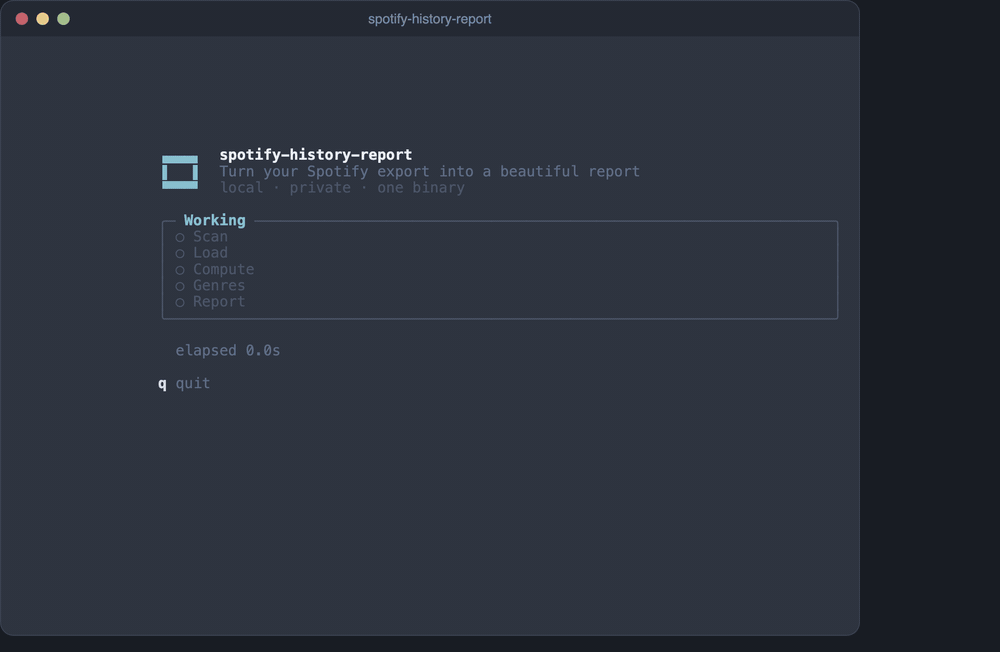
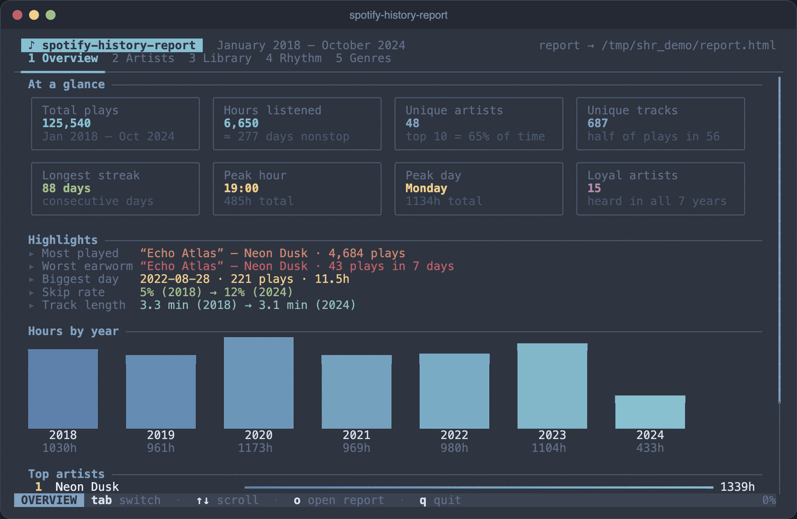
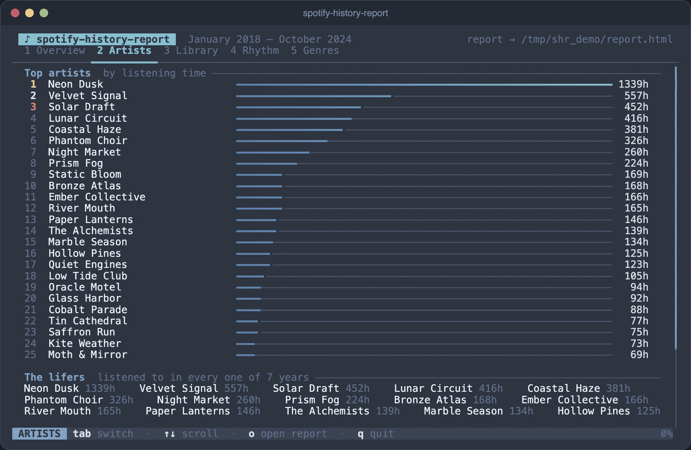
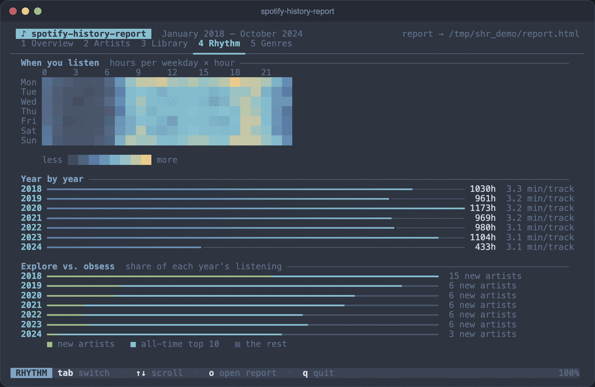
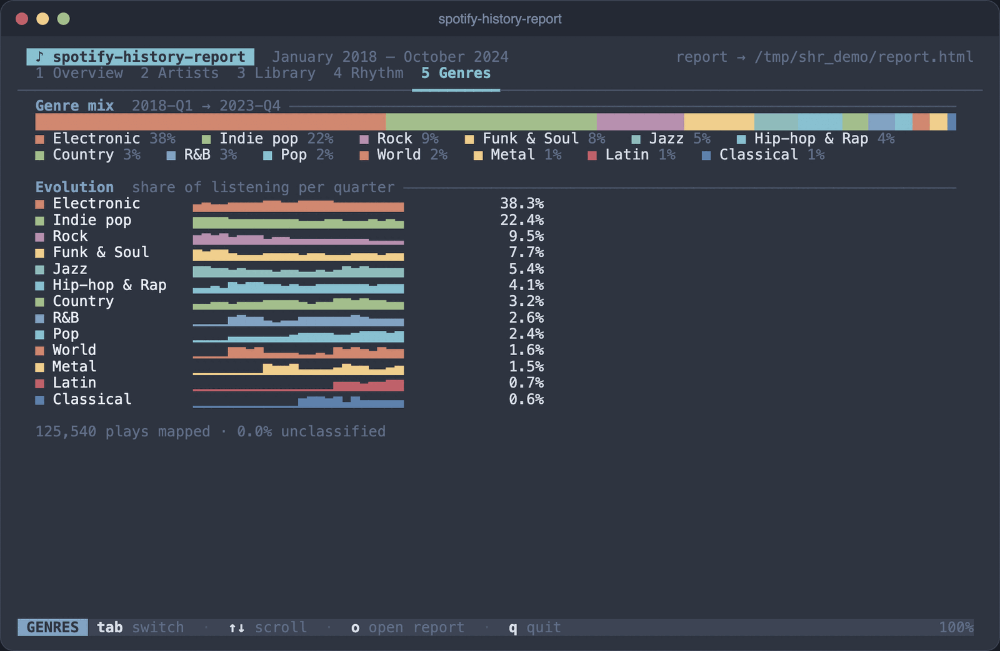

<p align="center">
  <br>
  <a href="https://odin-lang.org"></a>
  <a href="#the-tui"></a>
  <a href="LICENSE.md"></a>
  <a href="#2-build-the-tool"></a>
  <br><br>
</p>

<h1 align="center">
<code>▗▄▄▄▖</code><br>
<code>▐   ▌</code>&ensp;spotify-history-report<br>
<code>▝▀▀▀▘</code>
</h1>

<p align="center">
  <strong>Turn your Spotify data export into a beautiful, interactive HTML report.</strong><br>
  No account access needed. Nothing leaves your machine. One binary, zero dependencies.
</p>

<p align="center">
  <a href="#2-build-the-tool"></a>
  <a href="https://github.com/ParkWardRR/spotify-history-report/pulls"></a>
  <a href="#privacy"></a>
  <a href="#architecture"></a>
</p>

<p align="center">
  
  <br>
  <sub>The terminal UI, running on generated placeholder data (fictional artists).</sub>
</p>

---

## What is this?

You ask Spotify for your data. They send you a ZIP file. You run this tool on it. You get a single HTML page you can open in any browser — a full visual breakdown of everything you've ever listened to.

That's it. No Python, no npm, no Docker. Just one compiled binary.

## What's in the report?

| Section | What you'll see |
|:--------|:----------------|
| **Hours per year** | Bar chart of how much you listened, year over year |
| **Key stats** | Most-played song, worst earworm, longest streak, skip rate |
| **Discovery** | Are you exploring new music or replaying favorites? |
| **The lifers** | Artists you've listened to every single year |
| **Top 25 artists** | Horizontal bars ranked by total listening hours |
| **Earworms** | Songs you couldn't stop playing (most plays in any 7-day window) |
| **Session openers** | The songs you reach for first when you hit play |
| **Top albums** | Best albums by total listening time |
| **Never-skipped** | Songs with 15+ plays and zero skips — pure commitment |
| **Favourites, obsessions, rediscoveries** | Long-term favourites, what you're bingeing now, and old favourites you've forgotten, as separate lists |
| **Genre evolution** | Stacked area chart of genre share over time (requires LLM) |
| **Heatmap** | When you listen — day of week × hour of day |

## Quick start

### 1. Get your data

Go to [spotify.com/account/privacy](https://www.spotify.com/account/privacy/) and request your **Extended Streaming History**. Spotify sends it within a few days as a ZIP containing `Streaming_History_Audio_*.json` files.

### 2. Build the tool

```bash
git clone https://github.com/ParkWardRR/spotify-history-report
cd spotify-history-report
odin build src/ -out:spotify-history-report -o:speed
```

> Requires [Odin](https://odin-lang.org/) — `brew install odin` on macOS, or grab a release from [odin-lang.org/docs/install](https://odin-lang.org/docs/install/).

> **Prefer not to build?** Download a prebuilt archive for macOS or Linux (arm64 and amd64) from the [latest release](https://github.com/ParkWardRR/spotify-history-report/releases/latest), extract it, and run `./spotify-history-report`. On macOS, clear the download quarantine flag first: `xattr -d com.apple.quarantine spotify-history-report`. Linux builds need glibc 2.35 or newer.

### 3. Run it

```bash
./spotify-history-report ~/Downloads/my_spotify_data/
```

That's it. Open `spotify_report.html` in your browser.

### 4. Configure an LLM API key

Genre classification requires an LLM. Provide an API key via environment variable, CLI flag, or config file:

```bash
# Environment variable (easiest)
ANTHROPIC_API_KEY=sk-ant-... ./spotify-history-report ~/Downloads/my_spotify_data/

# CLI flag
./spotify-history-report ~/Downloads/my_spotify_data/ --anthropic-key sk-ant-...

# Interactive config setup (saves to ~/.config/spotify-history-report/config.json)
./spotify-history-report --setup
```

Supported providers: **Anthropic** (Claude), **OpenAI** (GPT-4o-mini), **OpenRouter** (any model). The tool auto-detects which key is available if you set multiple. Classifications are cached in `.genre_cache.json` alongside your data so subsequent runs are instant.

---

<details>
<summary><strong>Try it with sample data first</strong></summary>

The repo includes sample data with fictional artists so you can see what the output looks like before using your own data:

```bash
./spotify-history-report sample/ sample_report.html
open sample_report.html
```

All artist and track names in the sample are made up — no real listening data is included.

</details>

---

## The TUI

A full-screen terminal app built on a small port of [Bubble Tea](https://github.com/charmbracelet/bubbletea)'s Elm architecture (Model / Update / View, a message queue fed by a worker thread, timer commands, and a line-diffing renderer) with [Lip Gloss](https://github.com/charmbracelet/lipgloss)-style styling and [Bubbles](https://github.com/charmbracelet/bubbles)-style components (spinner, gradient progress bar, viewport, text input).

While your data is processed you get a live pipeline view; when it finishes the report is written and you land in a tabbed dashboard:

| Tab | Contents |
|:----|:---------|
| **Overview** | Stat cards, highlights, hours-by-year column chart, top artists, platforms |
| **Artists** | Top 25 bars, the lifers, top artists by year |
| **Library** | Top albums, earworms, session openers, never-skipped |
| **Rhythm** | Weekday × hour heatmap, year by year, explore vs. obsess |
| **Habits** | Long-term favourites, current obsessions, rediscoveries, what you're likely to replay, session openers and closers |
| **Genres** | Genre mix bar and per-genre sparklines over time |

<table>
  <tr>
    <td><br><sub><b>Overview</b> — stat cards, highlights, hours by year</sub></td>
    <td><br><sub><b>Artists</b> — top 25 and the lifers</sub></td>
  </tr>
  <tr>
    <td><br><sub><b>Rhythm</b> — weekday × hour heatmap, explore vs. obsess</sub></td>
    <td><br><sub><b>Genres</b> — genre mix and per-genre sparklines</sub></td>
  </tr>
</table>

Keys: `tab` / `←` `→` / `1`–`6` switch tabs · `↑` `↓` `j` `k` / mouse wheel scroll · `o` open the report · `q` quit.
`--setup` is a TUI too (provider picker, masked key entry with paste support).

### Theme

Colors are the [Nord](https://www.nordtheme.com/) palette. In terminals with truecolor (`COLORTERM=truecolor`) the exact RGB values are used. Everywhere else the TUI sticks to the 16 ANSI slots using the same mapping as the official [Nord Terminal.app theme](https://github.com/nordtheme/terminal-app) (black=nord1, red=nord11, green=nord14, yellow=nord13, blue=nord9, magenta=nord15, cyan=nord8, white=nord5, bright black=nord3, bright cyan=nord7, bright white=nord6), so installing that theme makes it look right in Terminal.app. Override detection with `SHR_COLOR=truecolor|256|ansi|none`; `NO_COLOR` is respected.

When stdout isn't a terminal (or with `--plain`) it prints simple progress lines instead.

## Architecture

```
src/
├── main.odin      entry point, CLI flags, TUI / plain-mode dispatch
├── pipeline.odin  scan → load → compute → genres → report, reporting via `emit`
├── nord.odin      Nord palette + Nord.terminal ANSI slot mapping
├── term.odin      raw mode, window size, key/mouse/paste input decoding
├── tea.odin       Bubble Tea runtime: Msg/Cmd, event loop, diffing renderer
├── style.odin     Lip Gloss subset: colors, styles, borders, width, joins
├── widgets.odin   spinner, progress, viewport, text input, bars, sparklines
├── app.odin       main model: progress screen + tabbed dashboard
├── tabs.odin      dashboard tab contents
├── setup.odin     `--setup` TUI
├── tui.odin       static screens: --help, --guide
├── parser.odin    Spotify JSON deserialization, record → play conversion
├── calendar.odin  timestamps → local time (named timezone, true day ordinals)
├── identity.odin  track identity: URI resolution, duplicate candidates, overrides
├── scores.odin    ACT-R activation, favourites/obsessions/rediscoveries, held-out evaluation
├── stats.odin     all metric computation (sessions, streaks, heatmap, genre share)
├── config.odin    config file (~/.config), provider resolution, genre cache
├── llm.odin       LLM genre classification (Anthropic/OpenAI/OpenRouter via curl)
└── html.odin      HTML report generation (template embed + JSON injection)

template/
└── report.html    self-contained HTML/CSS/JS template, renders from a DATA blob
```

The HTML template is embedded at compile time via Odin's `#load` directive — the binary is fully self-contained. At runtime, the tool computes all metrics, serializes them as JSON, injects the blob into the template at a marker, and writes the result.

### Releases

`scripts/build-release.sh vX.Y.Z` builds the four archives and `SHA256SUMS` into `dist/` — macOS natively, Linux in Ubuntu 22.04 containers (OrbStack or Docker).

### How metrics are computed

| Metric | Method |
|:-------|:-------|
| Qualifying play | `ms_played >= 30000` and both track + artist present |
| Session detection | Gap > 30 minutes between consecutive plays |
| Earworm | Sliding 7-day window per track, report max plays |
| Longest streak | Consecutive calendar days with at least one qualifying play |
| Skip | `skipped: true` or `ms_played < 30000`, counted over every record with a track and artist (including the short plays dropped from the rest of the stats) |
| Never-skipped | 15+ qualifying plays and not a single skip as defined above |
| Loyalty | Artist has qualifying plays in every active year |
| Heatmap | Hours summed per (day-of-week, hour-of-day) bucket, in your timezone |
| Explore vs. obsess | Per year: % of time on top-10 all-time artists / other artists new that year / the rest (disjoint; a new artist who is also top-10 counts as top-10) |

Timestamps are converted to a named timezone (DST included) before bucketing, so days, streaks, weekdays and hours match your wall clock. Pick the zone with `--timezone Europe/Berlin`, a `"timezone"` key in the config file, or `$TZ`; the default is `America/Los_Angeles`. It needs the system zoneinfo database; without one the tool falls back to a fixed UTC−8 and says so in the report footer and progress output.

Rankings break ties by name, so the same export always produces the same report. A partial final year or quarter is kept and labelled as partial rather than dropped.

## Listening habits

Instead of one list ranked by lifetime hours, the **Habits** tab (and a section of the HTML report) separates what kind of favourite a track is. Each list shows its own definition:

| View | Definition |
|:-----|:-----------|
| **Long-term favourites** | 10+ plays across 6+ different months, and heard within the last 365 days of your history |
| **Current obsessions** | 5+ plays in the last 14 days of your history |
| **Rediscoveries** | 8+ plays across 3+ months, but silent for 365+ days; ranked by how well you knew them when they dropped out |
| **Likely to come back to** | Highest ACT-R activation: a memory model where recent and frequent plays count most and fade as a power law |
| **Reach-for-first / last song of the night** | Share of a track's plays that opened or closed a session |

The views overlap on purpose (a favourite you are bingeing this week is both). "Now" is the last play in your export, not today's date, so old exports still make sense. The memory model follows [Predicting Music Relistening Behavior Using the ACT-R Framework](https://dl.acm.org/doi/10.1145/3460231.3478846).

**Does the model actually work for you?** Don't take it on faith:

```bash
./spotify-history-report ~/Downloads/my_spotify_data/ --scores
```

prints the views, then holds out your most recent months, ranks the tracks you already knew, and reports how many of the top 20 you really replayed, next to "most recent" and "most played" baselines and a random-ranking floor. Which ranking wins depends on the listener: on one synthetic history with drifting taste, plain recency matched the best decay and beat the default. If another decay clearly wins on yours it says so; use it with `--decay 0.8`. If nearly every known track gets replayed (as in the daily-listening sample), the test can't separate the rankers and the output says that instead of showing a tie as a result.

## Track identity

Every play is matched to a Spotify track URI from your export, and the tool is explicit about what it does *not* know:

- **Matched by URI** — an exact identifier; the strongest evidence available offline.
- **Text only** — records without a URI are kept by exact title + artist and reported as unresolved.
- **Nothing is merged on fuzzy evidence.** Songs that differ only in case or punctuation (`Don't Stop` / `Dont Stop`) are listed as *near-duplicates* to review; songs that share a base title but are different versions (`Live`, `Remastered`, `Instrumental`, `Karaoke`, `Acoustic`, `Demo`, `Edit`, `Remix`, `Mono`/`Stereo`) are listed as *version families* and are never proposed as one recording. Accents are not folded either.

The report counts a *song* as exact title + artist text, so one song released on an album and a compilation (two URIs) counts once, while a URI whose track was renamed counts under each spelling.

```bash
./spotify-history-report ~/Downloads/my_spotify_data/ --identities   # coverage + review list, no LLM needed
```

This also writes `.shr/identities.json` next to your data (a derived cache; safe to delete). To act on a candidate, create `.shr/overrides.json` there:

```json
{
  "version": 1,
  "merges": [
    { "from": { "artist": "Fleet", "title": "Dont Stop" },
      "into": { "artist": "Fleet", "title": "Don't Stop" } },
    { "from": { "uri": "spotify:track:abc" }, "into": { "uri": "spotify:track:def" } }
  ],
  "keep_separate": [
    { "a": { "artist": "Fleet", "title": "Anthem" }, "b": { "artist": "Fleet", "title": "Anthem (Live in Paris)" } }
  ]
}
```

A reference is either a `uri` or both `artist` and `title`. Merges rewrite the plays on every run (your export is never modified), so deleting the file undoes them. `keep_separate` hides a pair from the review list. A typo in a key or an impossible merge stops the run with a message instead of being ignored. MusicBrainz and AcoustID lookups are planned (see the [roadmap](ROADMAP.md)).

## Genre classification

When an LLM API key is available, the tool sends your unique artist names to the LLM in batches of 150 and asks it to classify each into one of 14 genres (Hip-hop & Rap, Indie pop, Funk & Soul, Electronic, Rock, R&B, Jazz, Latin, Classical, Pop, Country, Metal, World, Other).

Results are cached in `.genre_cache.json` next to your data files. The cache is additive — new artists from future exports get classified and merged in.

The genre data powers a stacked area chart in the report showing how your listening taste evolved quarter by quarter.

| Provider | Default model | How to get a key |
|:---------|:--------------|:-----------------|
| Anthropic | `claude-sonnet-4-20250514` | [console.anthropic.com/settings/keys](https://console.anthropic.com/settings/keys) |
| OpenAI | `gpt-4o-mini` | [platform.openai.com/api-keys](https://platform.openai.com/api-keys) |
| OpenRouter | `anthropic/claude-sonnet-4-20250514` | [openrouter.ai/keys](https://openrouter.ai/keys) |

Priority: Anthropic > OpenAI > OpenRouter (auto-detected from env vars or config).

## LLM framework

See [`FRAMEWORK.md`](FRAMEWORK.md) for a structured prompt framework if you want an LLM to help you extend or customize the report. It covers the full analysis pipeline: data specification, six analysis layers, visualization hierarchy, color system, and interactivity patterns.

## Roadmap

See [`ROADMAP.md`](ROADMAP.md) for where this is going: correctness fixes to the
calendar and ranking code, a canonical track-identity layer, multi-source
annotations replacing the flat artist→genre map, listening-behaviour scores, and
an optional local audio-enrichment sidecar for similarity, clustering and
playlist ordering.

## Privacy

- **Your data never leaves your machine.** The tool reads local JSON files and writes a local HTML file. The only network calls are to the LLM API — and those only send artist names, not your listening history.
- **The HTML report is self-contained.** No analytics, no external requests, no tracking pixels. Open it offline.
- **The sample data uses fictional artists.** No real listening history is included in this repository.

## License

[Blue Oak Model License 1.0.0](LICENSE.md) — a modern, readable, permissive license.

---

<p align="center">
  <sub>Built with <a href="https://odin-lang.org">Odin</a> · Styled with <a href="https://www.nordtheme.com">Nord</a> · Data stays local</sub>
</p>
