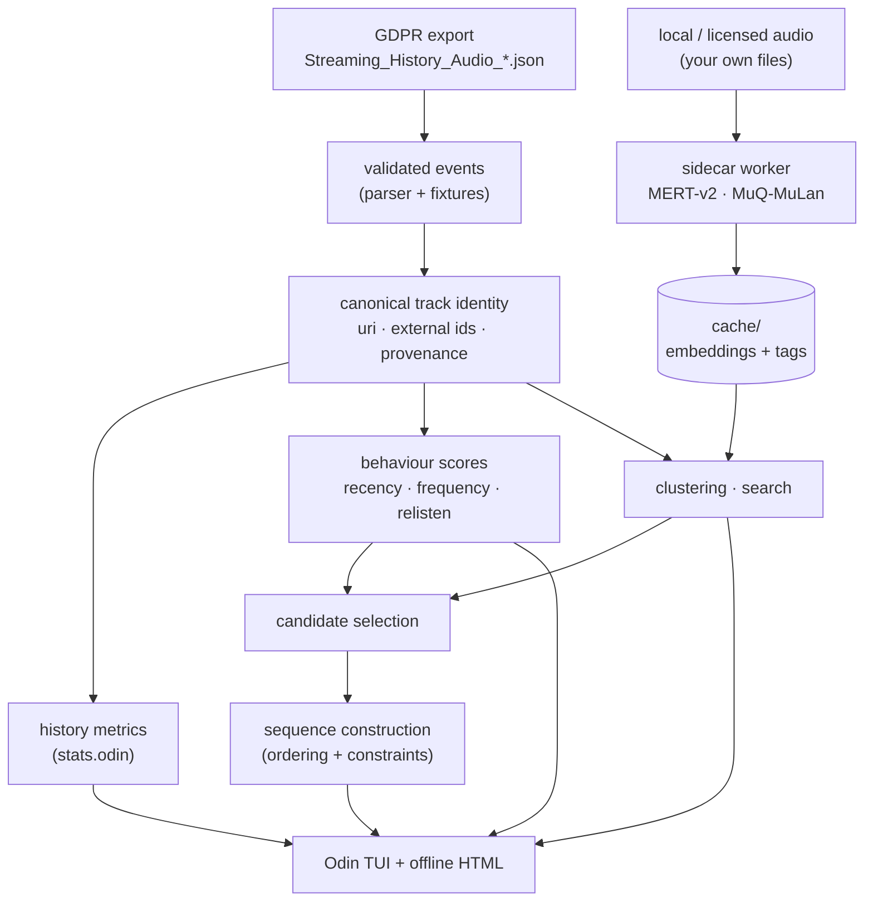

# Roadmap: from history stats to a music-information-retrieval tool

This is the development plan for `spotify-history-report`. It adopts the music
information retrieval (MIR) review of this repo: replace the single
"one LLM-assigned genre per artist" axis with a **hybrid** system — canonical
track identities, multi-source annotations, listening-behaviour scores, and
sequence-aware ordering — and fix the calendar/identity foundations before any
of that.

Two rules shape everything below:

1. **Correctness first.** Every advanced feature is downstream of calendar
   arithmetic, stable track identity, and deterministic ranking. Those are
   broken today (Phase 0), so new models would be built on sand.
2. **The core stays small, local and dependency-free.** The Odin binary keeps
   doing export → metrics → TUI + HTML with no ML runtime linked in. Audio
   models live in an optional sidecar that communicates through cached files on
   disk. You can delete the sidecar and the tool still works.

Status: **Phase 0 is implemented** (see its section for what shipped and the
decisions made along the way); Phases 1–7 are planned. Phase numbers are
dependency order, not a schedule.

---

## Target architecture



The boundary that matters: **a history export is not audio.** MERT and MuQ need
waveforms, which the export does not contain. Enrichment is therefore opt-in,
sourced from audio you already have locally, and never required for the base
report.

### Data-flow contract

| Artefact | Location | Owner | Format |
|:---|:---|:---|:---|
| Validated events | in memory | Odin core | `Play` |
| Track identities | `.shr/identities.json` | Odin core | versioned, schema-tagged |
| Annotations (genre/mood/tags) | `.shr/annotations.json` | Odin core + LLM + sidecar | versioned, multi-source |
| Audio embeddings | `.shr/embeddings/<model>@<rev>/` | sidecar | `.npy` + manifest |
| Clusters / 2D map | `.shr/clusters.json` | sidecar | versioned |

Every cache file carries `schema_version`, producing tool version, and for model
outputs the model id + revision. The Odin core must tolerate missing, stale or
unreadable caches by degrading, never by failing. `.genre_cache.json` is
migrated into `.shr/annotations.json` once (Phase 2) and then ignored.

---

## Phase 0 — Correctness foundations (blocking)

These are defects found by reading `src/parser.odin` and `src/stats.odin`. Fix
them before benchmarking anything, because several of them silently corrupt the
metrics that later phases are evaluated against.

| ID | Defect | Where | Fix |
|:---|:---|:---|:---|
| P0-1 | Day numbers are `year*366 + month*31 + day`, which are not consecutive calendar days | [stats.odin:266](src/stats.odin), [stats.odin:301](src/stats.odin), [stats.odin:641](src/stats.odin) | Store a true ordinal day on `Play` via `core:time/datetime.date_to_ordinal`; derive streaks, 7-day windows and gaps from it |
| P0-2 | Weekday mapping is shifted by one day | [parser.odin:201-215](src/parser.odin) | The Zeller variant used (`- 2*j` ≡ `+ 5*j` mod 7) is **Saturday-first**, not Sunday-first as the comment claims, so `(dow + 6) % 7` lands one day late. Replace with `datetime.day_of_week(ordinal)` (Sunday = 0) and map to the label array explicitly |
| P0-3 | Local time is a hard-coded `h -= 8` | [parser.odin:180-193](src/parser.odin) | Configurable named timezone (`--timezone`, config key, `TZ` fallback) resolved through `core:time/timezone.region_load` + `datetime_to_tz` against the system zoneinfo database; keep a fixed-offset fallback when no tzdata exists, and record which path was used in the report footer |
| P0-4 | `Play` and `Streaming_Record` drop the Spotify track URI | [parser.odin:11-35](src/parser.odin) | Parse and retain `spotify_track_uri` (plus `reason_start`, `reason_end`, `shuffle`, `offline`, `conn_country` for later use); prerequisite for Phase 1 |
| P0-5 | Tracks are keyed by `(title, artist)` | [stats.odin:7-10](src/stats.odin) | Keep as the *fallback* key only; route all keying through the Phase 1 identity layer |
| P0-6 | "New artists" and "all-time top 10" are accumulated independently, then the remainder is clamped to ≥ 0 | [stats.odin:222-259](src/stats.odin) | A new artist can also be a top-10 artist, so the three shares are not a partition. Assign each artist to exactly one bucket with a documented precedence (top-10 wins), or report overlapping shares explicitly instead of a stacked bar |
| P0-7 | Genre evolution unconditionally drops the maximum year | [stats.odin:600](src/stats.odin) | Decide completeness explicitly (compare last event date against the quarter/year end) and render partial periods as partial (hatched/dimmed) rather than deleting a possibly complete final year |
| P0-8 | Earworm `days` array is sorted while its parallel `months` array is not | [stats.odin:314-343](src/stats.odin) | Sort one array of structs `{ordinal, year, month}`; the current code only works by accident because input order happens to be monotone |
| P0-9 | Rankings are non-deterministic | [stats.odin:97](src/stats.odin), [:108](src/stats.odin), [:124](src/stats.odin), [:350](src/stats.odin), [:438](src/stats.odin), [:456](src/stats.odin), [:507](src/stats.odin), [:524](src/stats.odin) | Map iteration order is unspecified, so ties (and the `best_*` scans) can change between runs on identical input. Add explicit tie-breakers — value desc, then name/identity asc — everywhere |
| P0-10 | `longest_streak` starts at 1 | [stats.odin:273](src/stats.odin) | Empty input reports a 1-day streak; start at 0 and special-case the empty slice |
| P0-11 | Skip definition disagrees with the docs | [pipeline.odin:113](src/pipeline.odin) vs [README.md:192](README.md), [FRAMEWORK.md:42](FRAMEWORK.md) | Plays under 30 s are filtered out *before* stats, so skip rate only ever reflects the `skipped` flag. Either count short plays as skips (keep them in a separate pre-filter tally) or correct both documents. Same for "total hours", which the docs define over all records with a track name but the code computes over qualifying plays only |

### Phase 0 also delivers the test harness

There are no tests today. Phase 0 adds `tests/` with `core:testing` and
`odin test`, covering at minimum:

- **Calendar fixtures.** Known weekdays (2020-01-01 = Wednesday), DST
  transitions in the configured zone, leap day, month-end and year-end
  crossings. Concretely, today's day numbers make 2020-12-31 (`403 + 366y`)
  sort *after* 2021-01-01 (`398 + 366y`) and put Apr 30 → May 1 two "days"
  apart; both fixtures must fail before P0-1 and pass after.
- **Metric goldens.** A small synthetic export with hand-computed expected
  values for streak, earworm window, sessions, heatmap buckets.
- **Determinism.** Same input twice ⇒ byte-identical report JSON, with ties
  deliberately planted.
- **Parser robustness.** Missing optional fields, podcast/audiobook rows,
  `null` metadata, empty file, malformed JSON.

The sample export in `sample/` lacks `spotify_track_uri` and the newer export
fields, so it needs regenerating alongside P0-4 (still fictional artists).

CI: add a GitHub Actions workflow running `odin build` + `odin test` on macOS and
Linux. The self-hosted podman runner on `cairn.alpina.casa` is the fallback if
hosted runners can't get an Odin toolchain cheaply.

**Done when:** all fixtures pass, two consecutive runs on the sample produce
identical output, and the README/FRAMEWORK metric definitions match the code.

### Phase 0 outcome

Implemented. `odin test src -define:ODIN_TEST_TRACK_MEMORY=false` runs 22 tests
(calendar fixtures, metric goldens, tie determinism, parser robustness, and the
sample end to end). Decisions worth knowing:

- **P0-3 timezone:** `--timezone`, then the config file's `timezone`, then `$TZ`,
  then `America/Los_Angeles` (what the old fixed offset approximated). The
  resolved zone is shown in the progress output and the report footer. Without
  system zoneinfo it falls back to a fixed UTC−8 and says so.
- **Stdlib quirk:** `core:time/timezone` returns the *previous* offset for the
  exact second a DST change takes effect. `region_offset` in `calendar.odin`
  probes one second later to get the right answer; `test_timezone_follows_dst`
  pins both transitions.
- **P0-6:** buckets are now disjoint with precedence top-10 → new this year →
  rest. On the sample, 2020 used to sum to 184% (new 100 + top-10 84).
- **P0-7:** all quarters are kept; each carries a `partial` flag and the report
  labels it. The "<year> in progress" subtitle is now computed, not hard-coded.
- **P0-11:** skip rate follows the documented definition (short plays count as
  skips), and never-skipped now excludes any track with a sub-30s play. Total
  hours stays over qualifying plays and the *docs* were corrected, so it keeps
  matching the sum of hours by year. Consequence: the fictional sample, whose
  skips are uniformly random, no longer has any never-skipped track.
- **P0-4:** the sample export gained fabricated `spotify_track_uri`,
  `reason_*`, `shuffle`, `offline` and `conn_country` fields via
  `scripts/add-sample-fields.py`, so the URI path is exercised end to end.
- **P0-5:** all keying goes through `track_key`/`play_key` in `stats.odin`;
  Phase 1 changes that one function.

---

## Phase 1 — Canonical track identity

Identity resolution is its own layer, deliberately separate from similarity.
"The same recording" and "a similar-sounding track" are different questions and
must not share a code path.

Resolution chain, in order, each step recording its provenance:

1. **Spotify track URI from the export** when present — the only free, exact
   identifier the data gives us.
2. **External ids** attached opportunistically:
   [MusicBrainz](https://musicbrainz.org/doc/MusicBrainz_API) recording MBIDs.
3. **Metadata-match candidates** (normalised title/artist/album, duration
   window) — proposed, never auto-merged.
4. **Audio fingerprints** via [AcoustID/Chromaprint](https://acoustid.org/)
   *only* where local audio exists.
5. **Unresolved** — a first-class state. Ambiguity is preserved, not guessed.

Deliberate non-merges, per
[MusicBrainz's AcoustID guidance](https://musicbrainz.org/doc/Guides/AcoustID):
live, instrumental, karaoke, remastered and edited versions stay distinct
candidates. Fingerprints can confuse versions that differ only briefly or after
the fingerprinted window, so a fingerprint hit raises confidence — it does not
by itself collapse two identities.

Implementation notes:

- `Track_Identity { id, spotify_uri, mbid, title, artist, album, duration_ms,
  source, confidence, merged_from[], user_override }`, persisted in
  `.shr/identities.json`.
- MusicBrainz requires a descriptive User-Agent and rate limiting (~1 req/s);
  all lookups are cached and resumable, and the tool works fully offline with
  lookups disabled (`--no-network`, default for identity enrichment).
- A `--identity-review` TUI view listing unresolved and low-confidence
  candidates, where a user decision is stored as the highest-precedence source.

Reference implementation worth reading first:
[Identifying Spotify tracks that I own](https://blog.ortham.net/posts/2025-01-07-spotify-streaming-history-part-4/)
(a blog write-up, not a study) connects streaming history → MBIDs → local files
→ AcoustID in roughly this shape.

**Done when:** every qualifying play resolves to an identity row; merges are
reversible; the identity report states how many plays resolved by URI, by MBID,
by fingerprint and not at all.

---

## Phase 2 — Annotations replace the flat genre map

The flat `{artist: genre}` dict is the single biggest modelling limitation: one
genre, one source, artist-level, no confidence, no way to disagree with it.

Replacement: a **track-level annotation record** holding many tags.

```
Annotation {
  target:     identity id (or artist id, explicitly scoped)
  namespace:  genre | subgenre | mood | instrumentation | era | language
  value:      string
  source:     user | llm | musicbrainz | sidecar-model
  model:      id + revision   (e.g. m-a-p/MERT-v2-30s@<rev>)
  confidence: f32 | null      (null where the source has no calibrated score)
  observed:   timestamp
}
```

Rules:

- **`unknown` ≠ `Other`.** Today unclassified artists silently become "Other"
  ([stats.odin:599-612](src/stats.odin)), which makes a missing annotation look
  like a real musical category. Keep them separate everywhere, including the
  chart legend, and report coverage as its own number.
- **User corrections win**, always, and survive re-classification.
- Multiple tags per track are normal; genre share is computed over a declared
  primary namespace, with the others available for filtering and search.
- The existing LLM classifier becomes *one* source among several, and stays the
  only one that needs network access.
- One-time migration from `.genre_cache.json`, tagged `source: llm` with the
  model that produced it where known (unknown for pre-existing caches).

**Done when:** the genre chart renders from annotations, artist-level and
track-level annotations coexist, coverage and `unknown` are reported, and user
overrides round-trip through a re-run.

---

## Phase 3 — Listening-behaviour scores

This is the highest value-per-effort phase after Phase 0: it needs no audio, no
network and no ML runtime — only the corrected event stream.

Build interpretable scores first, from
[Predicting Music Relistening Behavior Using the ACT-R Framework](https://dl.acm.org/doi/10.1145/3460231.3478846)
(2021), which found on 1.7M Last.fm events that recency and frequency predict
relistening, with co-occurrence and familiarity adding further lift:

| Score | Built from | Surfaced as |
|:---|:---|:---|
| Base-level activation | time-decayed play recency + frequency | "likely to enjoy again" |
| Rediscovery | high historical activation, long dormancy | "forgotten favourites" |
| Short-term obsession | peak density in a bounded window | earworms, *separated* from favourites |
| Long-term favourite | sustained activation across years | lifers, replacing raw lifetime hours |
| Session affinity | position within session, opener/closer rates | session openers, upgraded |

Only then consider sequence models:
[PISA / Transformers Meet ACT-R](https://arxiv.org/abs/2408.16578) (RecSys 2024)
models listening sessions with explicit repeat-awareness. It is the right
reference for next-session candidates, but it must beat the interpretable
baseline on held-out sessions (e.g. leave-last-session-out hit rate) before it
earns a place in the binary — and it likely runs in the sidecar, not in Odin.

**Exploration breadth.** Following
[Spotify Research on consumption diversity](https://research.atspotify.com/2020/12/algorithmic-effects-on-the-diversity-of-consumption-on-spotify),
measure diversity as *distance between things listened to*, not as a genre
count. Caveat stated in the UI: Spotify's version uses enormous playlist
co-occurrence data that a single user's export cannot reproduce. Without audio
embeddings this phase approximates distance with annotation overlap; with
Phase 4 it upgrades to acoustic distance.

Also stop ranking everything by lifetime hours in one list — split long-term
favourites, current obsessions and dormant candidates into separate views.

**Done when:** scores are computed from the corrected ordinals, every score has
a one-line plain-English explanation in the UI, and the TUI/HTML show
favourites / obsessions / rediscovery as distinct sections.

---

## Phase 4 — Optional audio enrichment sidecar

A separate process (Python, `uv`-managed, outside the Odin build) that reads
**local audio you already own** and writes caches the core can consume. Absent
sidecar ⇒ absent features, never a broken report.

| Model | Use | Notes |
|:---|:---|:---|
| [MERT-v2-30s](https://huggingface.co/m-a-p/MERT-v2-30s) | track-level acoustic representation for similarity, clustering, mood/instrument organisation | The model card recommends **task-specific layers** — do not assume one pooled embedding is best for everything. Its reported MARBLE wins (14 of 15 displayed metrics) are author-reported, with baselines not rerun and protocols possibly differing: promising, not proof. Weights are **CC BY-NC 4.0**, which constrains any future commercial use |
| [MuQ / MuQ-MuLan](https://github.com/tencent-ailab/MuQ) ([paper](https://arxiv.org/html/2501.01108v2)) | natural-language → music search ("warm, low-energy instrumental jazz") | An audio encoder alone does not give a text-search space; MuLan's joint space is what enables text queries |

Per [MARBLE](https://proceedings.neurips.cc/paper_files/paper/2023/file/7cbeec46f979618beafb4f46d8f39f36-Paper-Datasets_and_Benchmarks.pdf),
pick the representation per task rather than declaring one model universally
best — the cache layout is keyed by `<model>@<rev>` precisely so several can
coexist.

Hard constraints:

- **Audio sources:** local files the user owns, or explicitly licensed audio.
  Nothing else.
- **No Spotify content into models.** [Spotify's developer policy](https://developer.spotify.com/policy)
  prohibits ingesting Spotify Content into ML/AI models (not merely training on
  it) and separately restricts analysis and derived metrics. So: no downloading
  previews, no feeding API content to an embedding model. Whether that policy
  reaches a user's own GDPR export is a separate question this plan does not
  resolve — and none of this is legal advice or a claim about the current
  tool's compliance.
- Embeddings are derived data; they stay under `.shr/` next to the user's data
  and are never uploaded.
- The sidecar is resumable, content-addressed by audio hash, and prints what it
  would do under `--dry-run`.

**Done when:** `shr-enrich` embeds a local library incrementally, the core
reads the cache and degrades cleanly without it, and licensing + policy
constraints are documented in the README.

---

## Phase 5 — Clustering and the music map

Follows [Spotify Engineering: Recursive Embedding and Clustering](https://engineering.atspotify.com/2023/12/recursive-embedding-and-clustering):
embeddings → UMAP → HDBSCAN → recursively subdivide clusters that stay too
large. This discovers groups without committing to a genre taxonomy up front —
the direct answer to "14 hard-coded genres".

Two non-negotiables from [UMAP's own clustering guide](https://umap-learn.readthedocs.io/en/latest/clustering.html):

1. **Separate the embedding used for clustering from the pretty 2D map.** The
   parameters differ, and the docs explicitly warn that noise can produce
   apparent clusters.
2. **Never infer groups from islands on a scatterplot.** The map is navigation;
   cluster membership comes from the clustering run, and the UI must not imply
   otherwise.

Cluster labels come from annotations that are *already* in the cluster
(Phase 2), presented as evidence ("mostly tagged X") rather than as a verdict,
plus a user-editable name.

**Done when:** clusters are stable across reruns with a fixed seed, every
cluster view states what it was computed from, and the 2D map is labelled as a
projection.

---

## Phase 6 — Selection and ordering are two different tasks

The most useful distinction from
[The impact of playlist characteristics on coherence in user-curated music playlists](https://pmc.ncbi.nlm.nih.gov/articles/PMC11923031/)
(2025, >650,000 playlists) is that **coherence and diversity are independent**:
a playlist can span a wide tempo range and still be coherent if it changes
gradually, while a diverse set can be jarring in a bad order.

| Stage | Implementation |
|:---|:---|
| Candidate selection | Retrieve by acoustic and/or text similarity (Phase 4) or annotation filters (Phase 2), then re-weight by behaviour scores (Phase 3) for the requested familiarity ↔ discovery balance |
| Sequence construction | Reorder under transition costs plus explicit constraints: artist spacing, target energy trajectory, pinned opening/closing tracks, album-order preservation |
| Evaluation | Compare against shuffle and against the paper's greedy reordering baseline; measure transition coherence *and* whether the intended variety survived |

The greedy algorithm from that paper is the baseline to beat. Heavier
optimisation only ships if it wins in listening tests, not merely on a distance
score — the paper's own review finds mixed evidence on how much ordering
matters to listeners, so **"smoothest possible" is a selectable objective, not
the default assumption**. Output is a plain M3U/CSV plus an in-TUI preview; no
Spotify write-back.

**Done when:** given a selection, the tool emits shuffled / greedy / optimised
orderings with their coherence and diversity numbers side by side, and the
objective is user-selectable.

---

## Phase 7 — Evaluation, so we know whether matching works

Impressive-looking nearest neighbours are not evidence. Before trusting
similarity or text search:

- **[IncompeBench](https://arxiv.org/html/2602.11941v1)** (2026 preprint):
  1,574 permissively licensed snippets, 500 queries, >125,000 graded relevance
  judgements — fine-grained evaluation including exclusions such as "without
  vocals". Run text-search changes against it rather than eyeballing results.
- **Neighbourhood inspection:** for a sample of tracks, record whether
  neighbours share instrumentation, production, genre or mood. These are not
  interchangeable, and knowing which one an embedding is actually tracking
  decides where it belongs in the UI.
- **Behaviour scores:** held-out temporal split (train on all but the last N
  sessions), report hit rate / NDCG against the trivial recency and frequency
  baselines.
- **Orderings:** blind A/B listening comparisons; the win condition is listener
  preference, not a lower distance sum.

A `docs/evaluation.md` records every run with model revisions and dates, so
claims in the README stay traceable.

---

## Sequencing

| Phase | Depends on | Rough size | Needs network? | Needs audio? |
|:---|:---|:---|:---|:---|
| 0 Correctness + tests + CI | — | days | no | no |
| 1 Identity | 0 | days | optional | optional |
| 2 Annotations | 1 | days | LLM only | no |
| 3 Behaviour scores | 0 | days | no | no |
| 4 Sidecar embeddings | 1 | weeks | model download | yes |
| 5 Clustering / map | 4 | days | no | no |
| 6 Selection + ordering | 3, 5 | weeks | no | partly |
| 7 Evaluation | 4, 6 | ongoing | benchmark download | yes |

Phase 3 can run in parallel with 1–2 once Phase 0 lands; it is the shortest
path to visibly better output.

**Reading order for the next development pass:** coherence paper → ACT-R
relistening study → Spotify's recursive clustering article → MuQ-MuLan →
MERT-v2 → IncompeBench. That runs from immediately useful to most experimental.

**Where to watch for new work:** [ISMIR proceedings](https://ismir.net/conferences/ismir-2025/) ·
[Transactions of ISMIR](https://transactions.ismir.net/) ·
[MIREX](https://music-ir.org/mirex/wiki/MIREX_HOME) (community evaluations —
useful for telling benchmarked methods from unvalidated demos).

---

## Cross-cutting constraints

**Privacy.** Unchanged and non-negotiable: listening history never leaves the
machine. Current network calls send artist names to an LLM only. Phase 1 adds
optional MusicBrainz/AcoustID lookups (titles, artists, fingerprints — opt-in,
disabled by default, documented); Phase 4 downloads model weights but uploads
nothing. Every network feature must have an off switch and `--no-network` must
disable all of them.

**Budget.** Approximately $0 in software and services on existing hardware: the
papers are free to read and AcoustID is free for non-commercial use. Excludes
electricity, any audio purchases, and optional paid LLM calls. Free to use is
not the same as freely licensed — MERT-v2's CC BY-NC weights are the obvious
example.

**Performance.** The base pipeline must stay interactive on a decade of
history: one pass over events where possible, no regressions beyond ~2× current
compute time from Phase 0's ordinal/timezone work. Sidecar work is batch and
resumable; it never blocks the report.

**Dependencies.** The Odin binary keeps zero third-party dependencies and no ML
runtime. Anything requiring Python, PyTorch, UMAP or HDBSCAN lives in the
sidecar behind the file-cache boundary.

**Documentation.** `FRAMEWORK.md` describes a flat artist→genre map and a fixed
Pacific offset; it is updated alongside Phases 0 and 2 so the LLM-facing spec
matches the implementation.

---

## Open decisions

- **Primary genre namespace:** keep the 14 fixed labels as the default primary
  axis for continuity, or derive the primary axis from Phase 5 clusters once
  they exist? (Leaning: keep the fixed axis for the headline chart, add clusters
  as a parallel view.)
- **Sidecar language and packaging:** Python + `uv` is the obvious choice for
  MERT/MuQ; the alternative is a prebuilt ONNX runtime path with a smaller
  footprint but much more integration work.
- **Local library discovery:** ask for a directory, or read an existing
  Beets/Navidrome/Plex database when present?
- **How much Phase 6 belongs in this tool at all** versus a sibling binary —
  playlist construction is a different product from a history report, and
  bundling it risks making the report worse.

## Non-goals

- Spotify API integration, playback control, or writing playlists back to
  Spotify.
- Downloading audio from Spotify or any streaming service.
- Training or fine-tuning models on anyone's listening data.
- Shipping an ML runtime inside the main binary.
- Any claim that a model is "best" without an evaluation run recorded in
  `docs/evaluation.md`.
